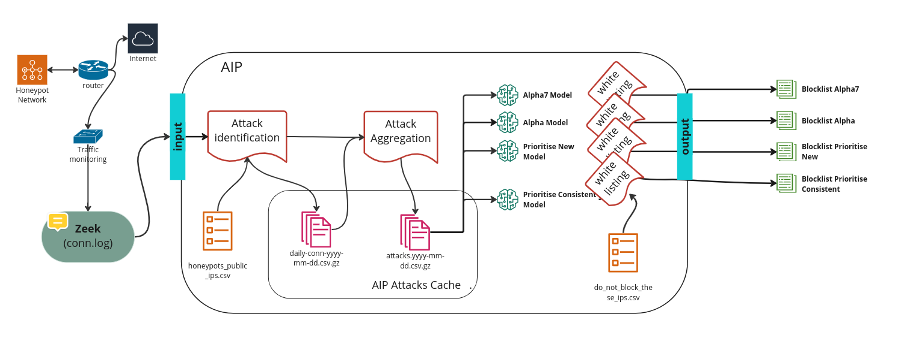

# Attacker IP Prioritization (AIP) Tool
[](https://github.com/stratosphereips/AIP/actions/workflows/python-ci-tests.yml)
[](https://github.com/stratosphereips/AIP/actions/workflows/github-code-scanning/codeql)
[](https://github.com/stratosphereips/AIP/actions/workflows/docker-hub.yml)
[](https://github.com/stratosphereips/AIP/actions/workflows/docker-publish.yml)

[](https://hub.docker.com/r/stratosphereips/aip)
[](https://github.com/stratosphereips/AIP/issues/)
[](https://github.com/stratosphereips/AIP/issues?q=is%3Aissue+is%3Aclosed)
[](https://github.com/stratosphereips/AIP/pulls?q=is%3Aopen)
[](https://github.com/stratosphereips/AIP/pulls?q=is%3Aclosed)


The Attacker IP Prioritization (AIP) is a tool to generate efficient and economic IP blocklists based on network traffic captured from honeypot networks. 

With the advent of 5G, IoT devices are directly connected often without firewall protection. Therefore we need blocklists that are small, efficient and economic. The AIP structure is shown below.



## AIP Models

Each AIP model generates its own blocklist based on a specific criteria. The main models are:

1. **Prioritize New (PN)**
    - Focuses on IPs that are new or have not been seen frequently in previous data.
    - Useful to identify emerging attackers that are starting to target a network.
2. **Prioritize Consistent (PC)**
    - Focuses on IPs that have consistently attacked over time in previous data.
    - Useful to identify persistent attackers that continuously target a network.
3. **Alpha**
    - Provides a baseline identifying all attackers seen in the last 24 hours.
    - Useful to compare the effectiveness of other models.
4. **Alpha7**
    - Provides a baseline identifying all attackers seen in the last 7 days. 
    - Useful to further compare the effectiveness of other models.
5. **Random Forest**
    - Focuses on IPs that are more likely to attack in the future.
    - A more experimental approach to increase blocklist efficiency.


## Setup

AIP can run with Docker (recommended) or directly with Python. Either way, it needs two things:

1. **Zeek logs** in `data/raw/`, one folder per day (for example `data/raw/2024-10-22/conn.*`). With Docker you can point AIP to your Zeek logs folder instead of copying them.
2. **Your honeypot IPs** in `data/external/`. Copy the example files and edit them:

    ```bash
    cp data/external/honeypots_public_ips_example.csv data/external/honeypots_public_ips.csv
    cp data/external/do_not_block_these_ips_example.csv data/external/do_not_block_these_ips.csv
    ```

    - `honeypots_public_ips.csv` (required): the public IPs of your honeypots. AIP only looks at traffic sent to these IPs.
    - `do_not_block_these_ips.csv` (optional): IPs that must never appear in a blocklist.

### Run with Docker

From the AIP folder, assuming your Zeek logs are in `/opt/zeek/logs/`:

```bash
docker run --rm \
  -v /opt/zeek/logs/:/home/aip/AIP/data/raw:ro \
  -v ${PWD}/data/:/home/aip/AIP/data/:rw \
  --name aip stratosphereips/aip:latest bin/aip
```

This runs all models for today. To use any of the [commands](#commands) below, write them after `bin/aip`. For example, to run all models for one day:

```bash
docker run --rm \
  -v /opt/zeek/logs/:/home/aip/AIP/data/raw:ro \
  -v ${PWD}/data/:/home/aip/AIP/data/:rw \
  --name aip stratosphereips/aip:latest bin/aip run-models --start-date 2026-10-12 --end-date 2026-10-12
```

To build the image yourself, see the [Docker guide](etc/docker/README.md).

### Run with Python

```bash
git clone https://github.com/stratosphereips/AIP.git ~/AIP
cd ~/AIP
python3 -m venv aip-venv
source aip-venv/bin/activate
pip install -r requirements.txt
export PYTHONPATH=$(pwd)/lib
bin/aip --help
```

Run `source aip-venv/bin/activate` and the `export PYTHONPATH` line again each time you open a new terminal.

## Commands

| What you want | Command |
|---|---|
| Run all models for today | `bin/aip` |
| Run all models for one day | `bin/aip run-models --start-date 2026-10-02 --end-date 2026-10-02` |
| Run all models for several days | `bin/aip run-models --start-date 2026-10-01 --end-date 2026-10-12` |
| Run only one model | Add `--model` with `Alpha`, `Alpha7`, `Prioritize_New`, `Prioritize_Consistent` or `Random_Forest` |
| Rebuild the attacker history from a date until today | `bin/aip rebuild-kb --start-date 2026-10-01` |

Things to know:

- If you leave out `--end-date`, it is today. So `--start-date` alone runs every day from that date until today.
- The blocklist for a day is built from the attacks seen on the days before it.
- Blocklists are saved in `data/output/<model name>/`.
- The attacker history is what the Prioritize and Random Forest models learn from. AIP builds it on its own as it runs.
- To see what AIP is doing, add `-v` (progress) or `-d` (full detail) right after `bin/aip`, for example `bin/aip -v run-models`.
- See all options with `bin/aip --help`.

## License

The Stratosphere AIP tool is licensed under [GNU General Public License v3.0](https://github.com/stratosphereips/AIP/blob/main/LICENSE).

## About
This tool was developed at the Stratosphere Laboratory at the Czech Technical University in Prague. This is part of the [Stratosphere blocklist generation project](https://mcfp.felk.cvut.cz/publicDatasets/CTU-AIPP-BlackList/).

This tool was originally born from the bachelor thesis of Thomas O'Hara, [The Attacker IP Prioritizer: An IoT Optimized Blacklisting Algorithm (2021)](https://dspace.cvut.cz/handle/10467/96722).
